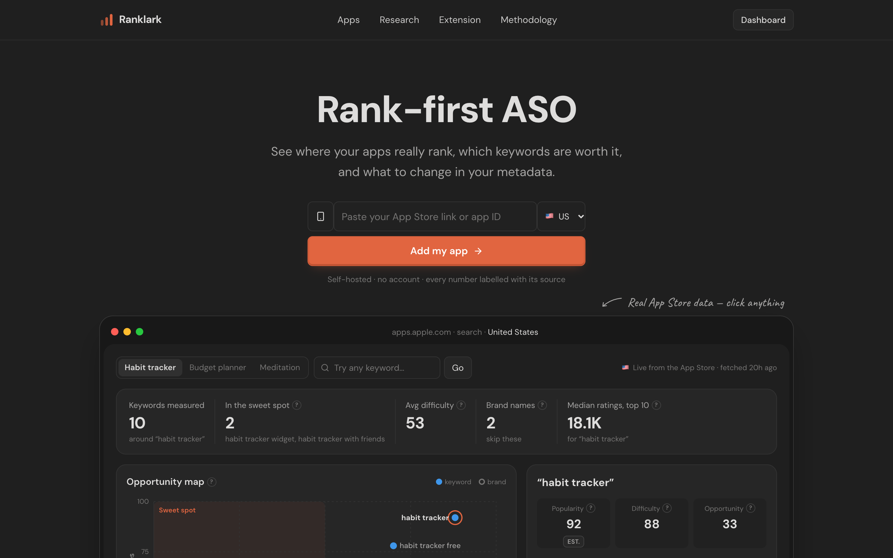
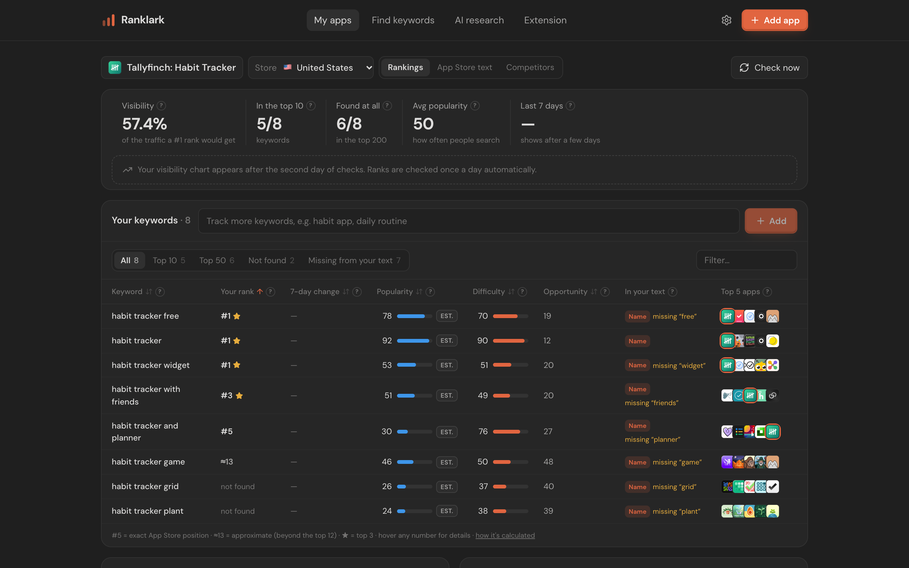
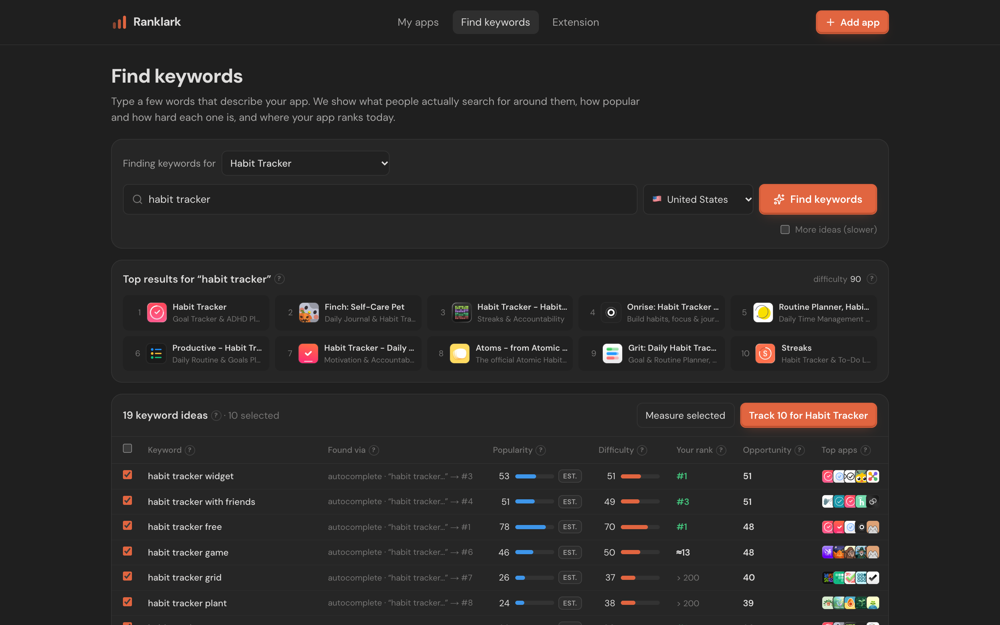
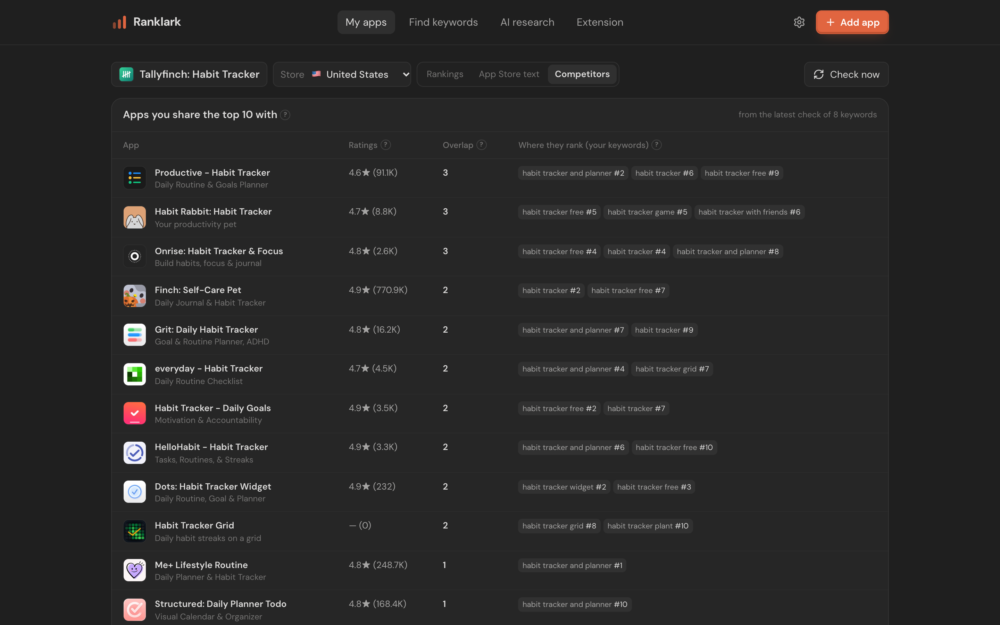
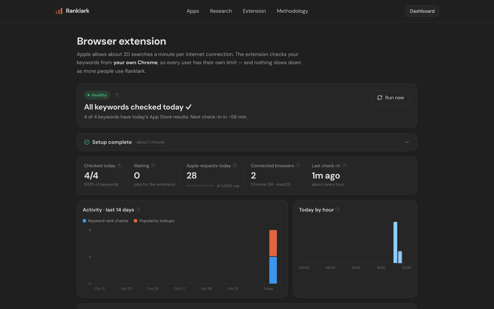
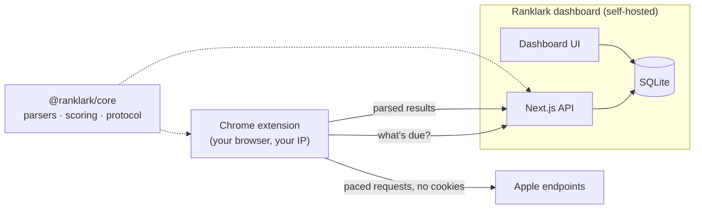

<div align="center">


# Ranklark

**Rise early, rank higher.** Open-source, self-hosted App Store Optimization for indie app makers.

[](https://github.com/hmqiwtCode/ranklark/actions/workflows/ci.yml)
[](LICENSE)
[](CONTRIBUTING.md)



</div>

Track where your iOS apps really rank for each keyword, find keywords worth targeting, and audit your
metadata, without a monthly subscription. Every number shows where it came from: **Apple Ads** (Apple's
data), **ASC** (your App Store Connect) or **Est.** (a disclosed formula). With no signal, the UI shows
"—", never a made-up default.

## Features

- **Real rank tracking.** True App Store order for the top ~12 (from the web store), plus the iTunes API
  position out to 200. One search updates the ranks of all your apps for that term.
- **Popularity and difficulty.** Apple's own popularity via the Apple Ads API when you connect it; otherwise
  a transparent autocomplete-based estimate. Difficulty comes from the strength and relevance of the top 10.
- **Visibility and opportunity** scores, with history charts and metadata-change markers.
- **Keyword research.** Expand a seed through App Store autocomplete, score the results, and add them to an
  app in one click. Brand terms are detected and excluded.
- **AI research, bring your own Claude.** Add your Claude API key (kept in your browser) or connect Claude
  Code over MCP. A planner → workers → analyst → checker loop gathers real App Store evidence and recommends
  keywords plus an App Name, Subtitle and Keyword field. Every claim cites a fact, and the whole process is
  drawn live as a graph.
- **Metadata audit.** Character and byte limits, where each tracked keyword is covered (title / subtitle /
  keyword field), wasted duplicates. Optional App Store Connect sync for every localization.
- **Competitors and store profiles** for any app: ratings histogram, chart position, what it ranks for.
- **Chrome extension, no login.** Checks run from your own browser with your own Apple rate limit, so a
  hosted dashboard scales past one server IP. Opening the dashboard connects it automatically.
- **Self-hosted and private.** One SQLite file. No account, no telemetry.

| App dashboard | Keyword research |
|---|---|
|  |  |
| **Competitors** | **Extension activity** |
|  |  |

<sub>Screenshots show real public App Store data for an example app; it isn't affiliated with this project.</sub>

## Quick start

Requires Node ≥ 20.19 (22 recommended) and pnpm.

```bash
git clone https://github.com/hmqiwtCode/ranklark.git
cd ranklark
corepack enable && pnpm install
pnpm dev                     # → http://localhost:3100
```

Paste an App Store link on the home page, add keywords, and ranks start filling in. To keep a daily history,
schedule `pnpm track` (see [self-hosting](docs/self-hosting.md)).

### Browser extension (optional, no login)

```bash
pnpm ext:build               # → load apps/extension/dist via chrome://extensions › Load unpacked
```

Open your dashboard in the same Chrome and it connects by itself. Nothing to sign in to and nothing to copy.
On another computer, enter the dashboard address in the extension popup. Details: [docs/extension.md](docs/extension.md).

## How it works



The dashboard can call Apple itself (default, fine for one person) or leave all fetching to connected
browsers (`ASO_FETCH_MODE=extension`, for hosting several people). Both sides parse with the same
`@ranklark/core` code.

## Repository layout

```
apps/web/          Next.js dashboard + API, grouped by feature (apps, keywords, research, agent, settings, showcase, extension)
apps/extension/    Chrome MV3 extension: one runner per task kind
packages/core/     Pure shared logic: Apple endpoint parsers, scoring, metadata rules, wire protocol (+ tests)
docs/              Architecture, extending, data sources, extension, self-hosting
```

| Doc | What's in it |
|---|---|
| [Architecture](docs/architecture.md) | Layers, dependency rules, data model, no-login pairing |
| [Extending](docs/extending.md) | Recipes: new data source, new extension task, new feature, schema change, new storefront |
| [Data sources](docs/data-sources.md) | Where every number comes from, optional Apple integrations, terms of use |
| [Extension](docs/extension.md) | Install, how it works, privacy, end-to-end test, publishing |
| [Self-hosting](docs/self-hosting.md) | Cron, production build, hosting for several people |
| [AI research](docs/ai-research.md) | Bring your own Claude: API key or Claude Code (MCP), how the agent loop works, privacy |

## Roadmap

- [ ] Verify the App Store Connect and Apple Ads clients against real accounts, and calibrate the popularity estimate
- [ ] App Store Connect Analytics: link each metadata change to impressions and downloads
- [ ] Write metadata back to App Store Connect after you confirm the diff
- [x] MCP server for Claude Code (AI research tools)
- [ ] Chrome Web Store listing
- [ ] Google Play support

Ideas and PRs are welcome. Start with [CONTRIBUTING.md](CONTRIBUTING.md).

## Disclaimer

Ranklark isn't affiliated with, endorsed by or sponsored by Apple Inc. App Store, iPhone and Apple Ads are
trademarks of Apple Inc. Some data comes from undocumented App Store web endpoints whose terms restrict
automated access. Ranklark keeps volume at personal levels, but review the terms yourself before running it
as a service. See [data sources](docs/data-sources.md#terms-of-use).

## License

[MIT](LICENSE) © 2026 hmqiwtCode and Ranklark contributors
