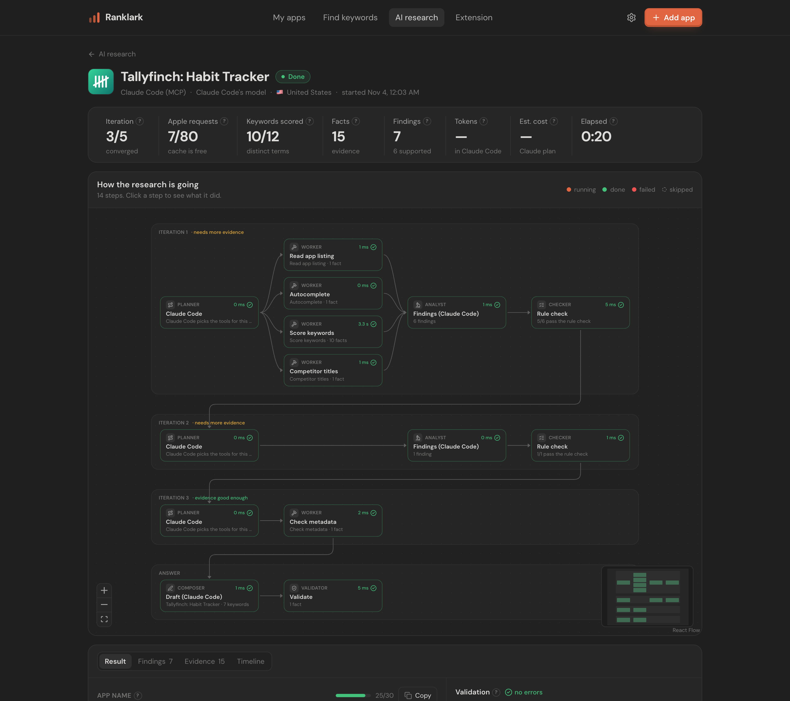
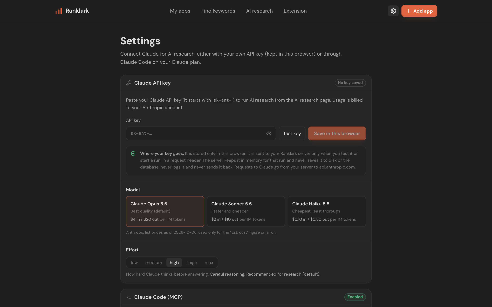
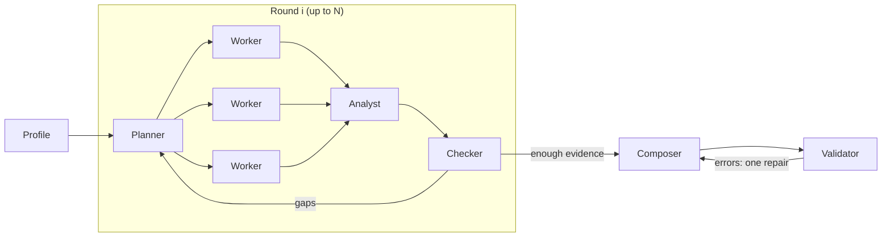
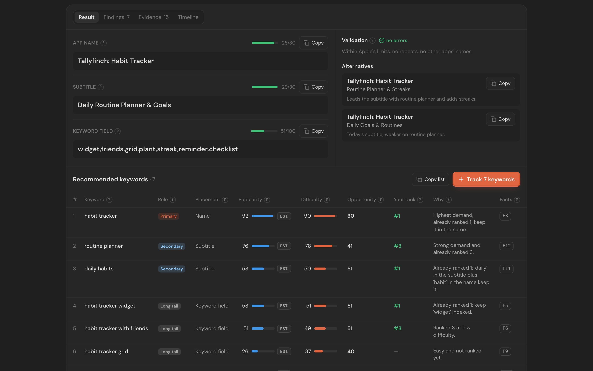

# AI research (bring your own Claude)

AI research finds the best keywords for one app (published, or just an idea) in one storefront. It then
recommends an **App Name**, **Subtitle** and **Keyword field** backed by real App Store data. Every step shows
live on the page as a graph.

You bring the Claude. Ranklark never ships a key and never sees your Claude account.



## Connect Claude

Open **Settings** (the gear in the top bar). There are two ways to connect.



### 1. Your Claude API key

Paste a key from [platform.claude.com](https://platform.claude.com), click **Test key** (this retrieves model
info and spends no tokens), then **Save in this browser**. Pick a model (Claude Opus 5.5 is the default;
Sonnet 5.5 and Haiku 5.5 are cheaper) and an effort level.

Where the key goes:

- It is stored **only in that browser** (localStorage).
- The browser sends it to your Ranklark server in the `x-anthropic-api-key` header, and only when you test the
  key or start a run.
- The server keeps it in memory for that run and passes it to the Claude SDK. It is never written to the
  database or the event log, never logged, and never returned in a response. API error messages are scrubbed of
  anything key-shaped.
- Usage is billed to your Anthropic account. The run page shows the tokens used and an **Est.** cost based on
  Anthropic list prices (the price date is shown next to it).

If you self-host for yourself only (`ASO_FETCH_MODE=server`), you can set `ANTHROPIC_API_KEY` in
`apps/web/.env.local` instead, and a browser key becomes optional. In extension mode, which is meant for hosting
several people, the server key is ignored and every browser must bring its own.

### 2. Claude Code over MCP (no API key)

Turn on **Claude Code (MCP)** in Settings. You get a token, shown once, and a command to paste into a terminal:

```bash
claude mcp add --transport http ranklark http://localhost:3100/api/mcp \
  --header "Authorization: Bearer rlm_…"
```

Then ask Claude Code in plain words, for example "Use ranklark to research keywords and a better name for app
1438388363 in the US store". Claude Code runs on your Claude plan and uses Ranklark's tools. The run appears
live on the AI research page, labelled *Claude Code*.

The MCP endpoint is Streamable HTTP, stateless, with JSON responses. Only a SHA-256 hash of the token is stored.
**Rotate** issues a new token, and **Disable** turns the endpoint off. Requests from another web origin are
refused.

| MCP tool | What it does |
|---|---|
| `start_research_run` | Opens a run for an app ID or an idea and returns `runId` plus the page that shows it |
| `get_app_profile` | Name, subtitle, category, ratings, description, the keywords you track |
| `expand_keywords` | App Store autocomplete for a seed |
| `score_keywords` | Popularity, difficulty, opportunity, brand flag, top apps and your rank (≤10 terms) |
| `competitor_phrases` | Phrases that recur in the top-10 app names |
| `record_findings` | Records findings with the fact IDs they cite (rule-checked) |
| `check_metadata` | Apple limits, wasted words, and keyword coverage for a draft |
| `submit_recommendation` | Validates the final name/subtitle/keywords. Returns issues to fix, or finishes the run |

## Run research

On **AI research**, choose one of your apps, paste an App Store link, or describe an idea. Then pick the store
and the goal (name a new app, or improve a live one). Optionally add starting keywords, a brand word the name
must keep, and notes. Under **Advanced** you can change the number of rounds, the Apple request budget and
the keyword budget.

## How it works



| Role | Who | Does |
|---|---|---|
| Planner | Claude | Picks what to look up next: seeds to expand, keywords to score, competitor titles to read |
| Workers | Ranklark | Fetch real App Store data through the same paced queues as the rest of the app. Each result is a **fact** (`F1`, `F2`, …) with a source label |
| Analyst | Claude | Writes **findings**: short claims that must cite fact IDs |
| Checker | rules, then Claude | Rejects findings that cite unknown facts. Flags numbers that appear in none of the cited facts. Claude then rules on each finding and decides whether there's enough evidence or lists the gaps |
| Composer | Claude | Writes the name, subtitle and keyword field, alternatives, and a ranked keyword list |
| Validator | Ranklark | Checks the draft against Apple's rules and the evidence (list below). Errors get one repair round |

What the validator checks. Each check says where the rule comes from:

| Check | Level | Source |
|---|---|---|
| Name ≤ 30, subtitle ≤ 30, keyword field ≤ 100 characters | error | Apple field limits |
| Other apps' names or brand keywords in any field; your keep-brand word missing from the name | error | Guideline 2.3.7 / your input |
| A recommended keyword citing a fact that doesn't exist | error | Evidence rule |
| Spaces after commas; repeated words in the keyword field (plurals count as duplicates) | warn | developer.apple.com/app-store/search |
| Keyword-field words already in the name, subtitle or category; "app", `#` or `@` in the keyword field | warn | developer.apple.com/app-store/search, /product-page |
| Prices or "free", "sale", "discount" in the name or subtitle; unverifiable claims ("#1", "best") in the subtitle | warn | Guideline 2.3.7 |
| Subtitle repeats words of the name | warn | Industry-observed, not Apple |
| A recommended keyword that was never scored, or whose placement doesn't match the text | warn | Evidence rule |

Ground rules:

- **The model never produces a number.** Popularity, difficulty, opportunity, rank and counts come from facts.
  Code copies them onto the recommended keywords. Unknown values show "—".
- **Apple pacing is unchanged.** Workers use the same per-host queues as everything else. Each run also has a
  hard Apple request budget, enforced inside the queue and shown live. Cached answers don't count.
- The loop stops when the checker is satisfied, at the round limit, or when the Apple or keyword budget runs
  out. A run that stops early still composes from the evidence it has.

Claude API details: structured outputs (`messages.parse` with zod schemas), adaptive thinking with summarized
thinking shown in each step's drawer, `effort` from Settings, and server-side fallback (`fallbacks: "default"`)
on models that offer it. Refusals and truncated answers are checked before any output is used.

## The run page



- **Graph**: one lane per round. Click any step to see its input, output, summarized thinking, tokens, model
  and timing, plus the facts or findings it produced.
- **Result**: name, subtitle and keyword field with character meters, validation issues, alternatives, the
  ranked keyword table (with source badges), **Copy**, and **Track N keywords**.
- **Findings**: grouped by round, with verdicts and clickable fact citations.
- **Evidence**: every fact with its source.
- **Timeline**: what happened, in order.

Runs are stored in SQLite (`agent_runs`, `agent_events`). Each event is streamed to the page with Server-Sent
Events and replayed from the database when you reopen a run.

## Limits

- In extension mode the server can't call Apple, so the agent only sees App Store data that's already cached.
- One storefront and one locale per run.
- The recommendation isn't written to App Store Connect. Copy it yourself.
- No real Claude run has been verified by the maintainers yet. Please report what you see.

## For contributors

Code: `apps/web/src/features/agent/`.

- `lib/contract.ts`: types shared by the server and UI.
- `lib/reduce.ts`: turns the event log into the view.
- `lib/validate.ts`, `lib/citations.ts`: the rule checks.
- `server/loop.ts`: the research loop, with every dependency injected for tests.
- `server/llm.ts`: the Claude client.
- `server/mcp.ts`: the MCP tools.

To try the whole flow without a key, run `RANKLARK_AGENT_SCRIPTED=1 pnpm dev`. That uses a deterministic
scripted model (shown as "scripted-test") with real Apple data.
