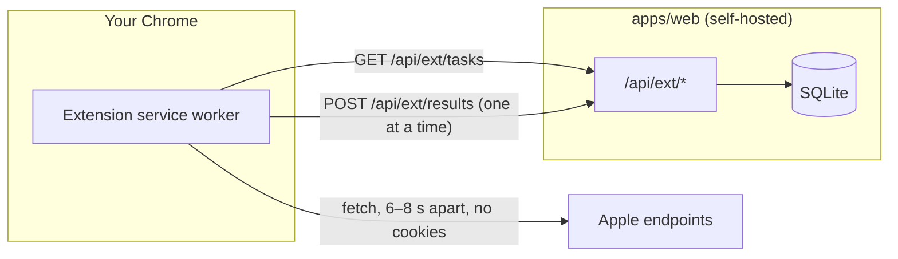

# Architecture

Ranklark is a pnpm monorepo with one rule: **logic that both the server and the extension need lives in
`packages/core`, and `packages/core` never touches Node, the database or the network.**

```
ranklark/
├── apps/
│   ├── web/                 Next.js 16 dashboard + API (SQLite via better-sqlite3)
│   └── extension/           Chrome MV3 extension (esbuild, no framework)
├── packages/
│   └── core/                Pure TypeScript shared by both apps (+ unit tests)
├── docs/                    You are here
└── scripts/                 Repo-level tooling (README screenshots)
```

## packages/core: pure and isomorphic

| Module | What it holds |
|---|---|
| `apple/itunes.ts` | iTunes Search + Lookup URL builders and parser (official API) |
| `apple/search-page.ts` | apps.apple.com search page parser: the true App Store order for roughly the top 12 |
| `apple/catalog.ts` | Catalog proxy parser: subtitle, ratings histogram, chart position |
| `apple/hints.ts` | Autocomplete URL, headers and parser (plist + JSON), plus the prefix-probe plan |
| `apple/storefronts.ts` | Storefront IDs and the locales Apple indexes in each storefront |
| `apple/pacing.ts` | Request spacing and daily caps, shared so both sides agree |
| `metadata.ts` | Tokenizer, field limits, keyword placement (title/subtitle/keywords), audit rules |
| `scoring.ts` | Difficulty, tap-through curve, visibility, opportunity, popularity estimate |
| `protocol.ts` | Server ⇄ extension wire types (`Task`, `TaskResult`, `DeviceStatus`, token format) |

Each source is a URL builder plus a parser, so it can be tested with plain fixtures (`packages/core/test`).

## apps/web: grouped by feature

```
src/
├── app/                      Next.js routes only: pages + API handlers, kept thin
├── features/                 One folder per product area
│   ├── apps/                 your apps: create/refresh, App Store Connect sync, public store profile
│   ├── keywords/             SERP snapshots → ranks, popularity, brand detection, dashboard queries
│   ├── research/             keyword discovery UI + shared keyword scoring reads
│   ├── agent/                AI research: contract, event reducer, rule checks, research loop, Claude client, MCP tools
│   ├── settings/             Settings page (Claude key, MCP token, data sources)
│   ├── showcase/             landing page live data
│   └── extension/            device pairing, task planning, result ingestion, activity overview
│       ├── components/       client UI for this feature
│       └── server/           server-only modules for this feature
├── server/                   Infrastructure shared by features
│   ├── apple/                rate-limited fetchers (server mode) + App Store Connect / Apple Ads clients
│   ├── db/                   SQLite connection, versioned migrations, row types
│   ├── jobs.ts               in-memory background jobs polled by the UI
│   └── config.ts             fetch mode (server | extension)
├── components/               Shared UI primitives (cards, charts, tooltips, actions)
└── lib/                      Client-safe helpers (formatting, glossary)
```

Dependency direction: `app → features → server → @ranklark/core`. Features can use each other's `server/`
modules. `server/` never imports from `features/`.

## Who talks to Apple



- **`ASO_FETCH_MODE=server`** (default): the Next.js process calls Apple itself through per-host queues
  (`server/apple/queue.ts`). This is right for one person on their own machine.
- **`ASO_FETCH_MODE=extension`**: the server never calls Apple. Each browser checks only its owner's keywords,
  so every user gets their own Apple rate limit. Use this when hosting for several people.

Both modes parse with the same `@ranklark/core` functions. If the extension's bundled parser fails after an
Apple page change, it sends the raw embedded JSON, and the server's newer parser handles it without a
Chrome Web Store review.

## No-login pairing

There are no accounts. A browser gets its own revocable device key in one of two ways:

1. **Automatic.** Opening the dashboard in a browser with the extension installed pairs it through
   `externally_connectable` (`features/extension/components/auto-connect.tsx`). A page can only pair the
   extension with its own origin, and can't take over a pairing with another dashboard.
2. **Popup.** Type the dashboard address and click Connect. The extension calls `POST /api/ext/connect`,
   which only answers `chrome-extension://` origins. Browsers set that header themselves, so a website you
   visit can't mint a key for your local dashboard.

The server stores only a SHA-256 hash of each key. Removing a browser on the Extension page revokes it at once.

## Data model

SQLite, append-only history (see `apps/web/src/server/db/migrations.ts`):

| Table | One row per |
|---|---|
| `apps` | App Store app (yours, `is_mine = 1`, or a competitor you opened) |
| `keywords` | (app, storefront, term) you track |
| `serp` | (term, storefront, day): top 10, full API order, web order, difficulty |
| `ranks` | (app, storefront, term, day): displayed rank, web rank, API rank |
| `popularity` | (term, storefront, source): Apple Ads value or our estimate |
| `hints_cache` | (prefix, storefront, day): autocomplete reuse across terms |
| `metadata_snapshots`, `localizations` | Metadata history and App Store Connect locales |
| `ext_devices`, `ext_events` | Paired browsers and their recent activity |
| `agent_runs`, `agent_events` | AI research runs and their append-only event log (replayed to draw the graph) |
